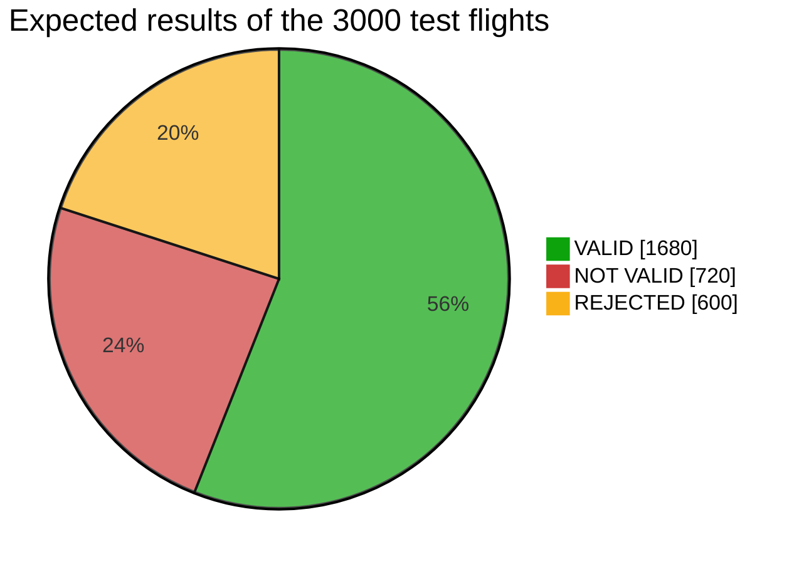
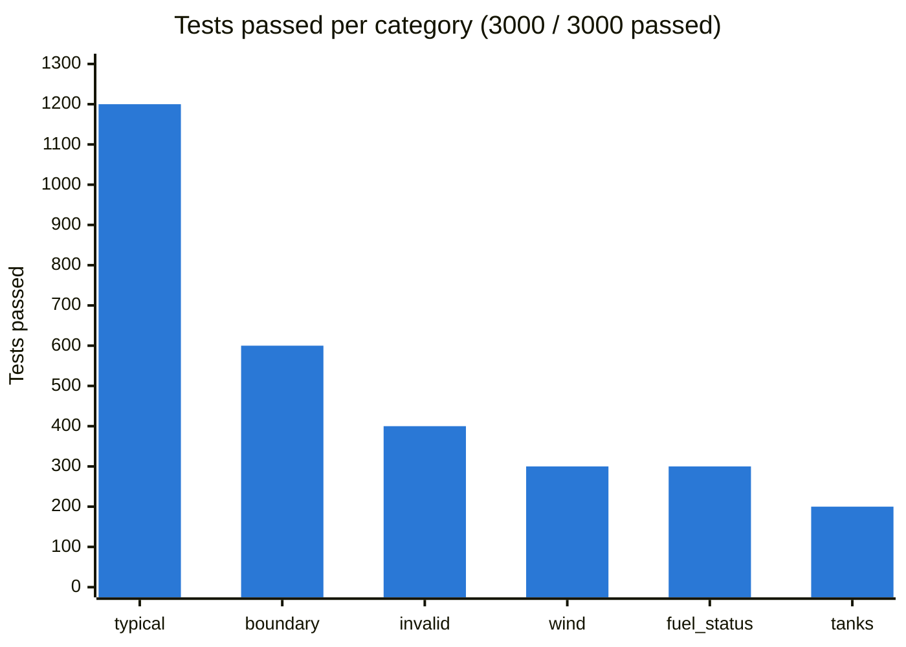
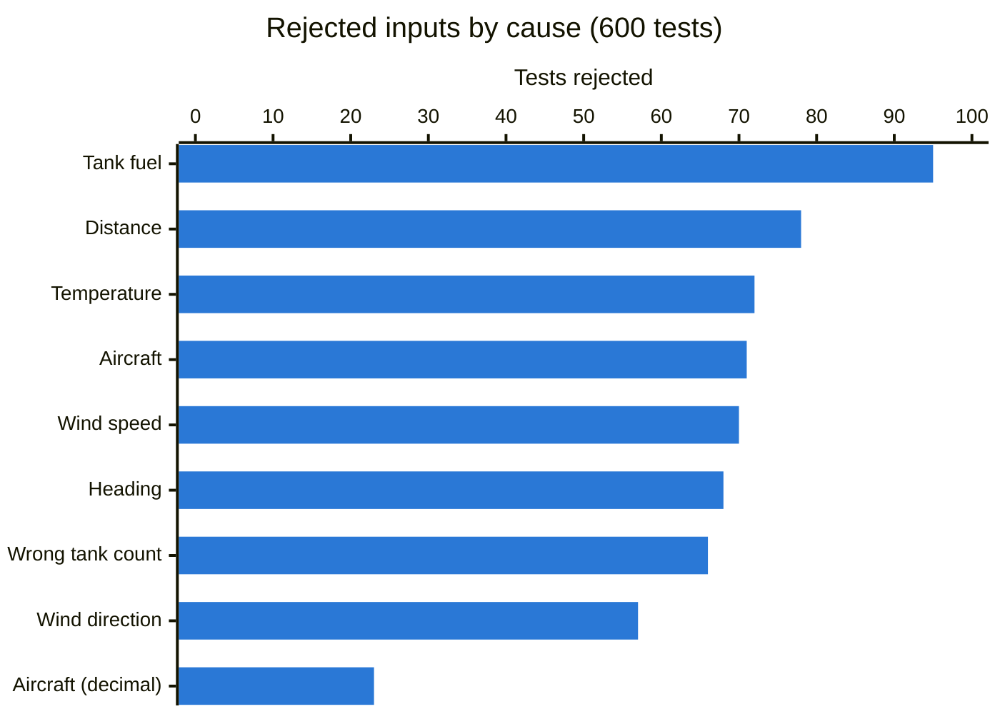
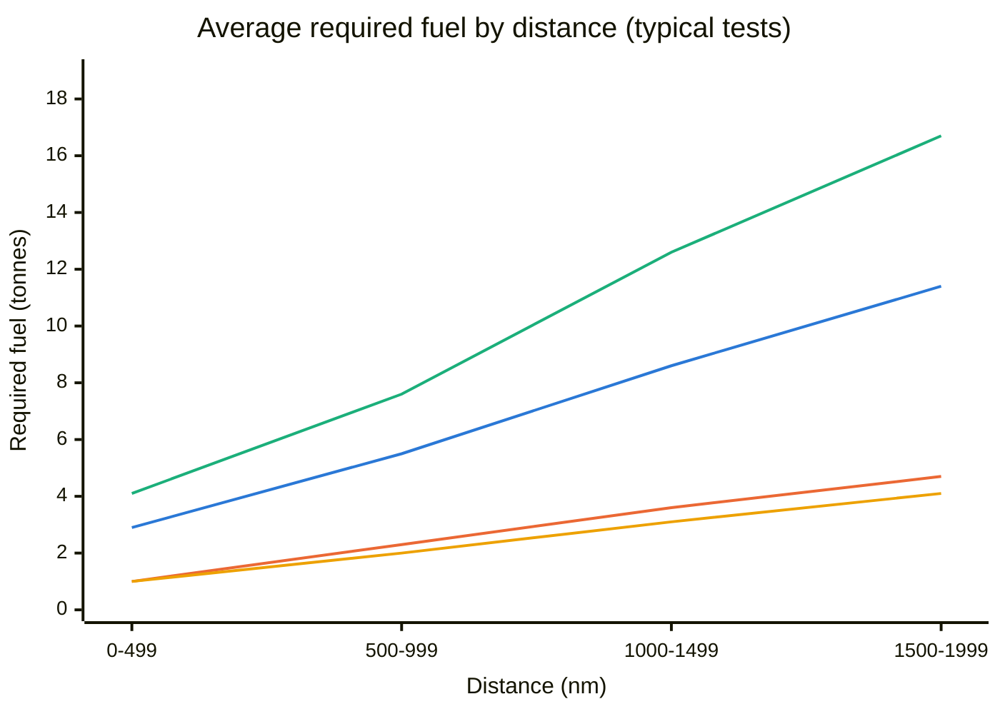
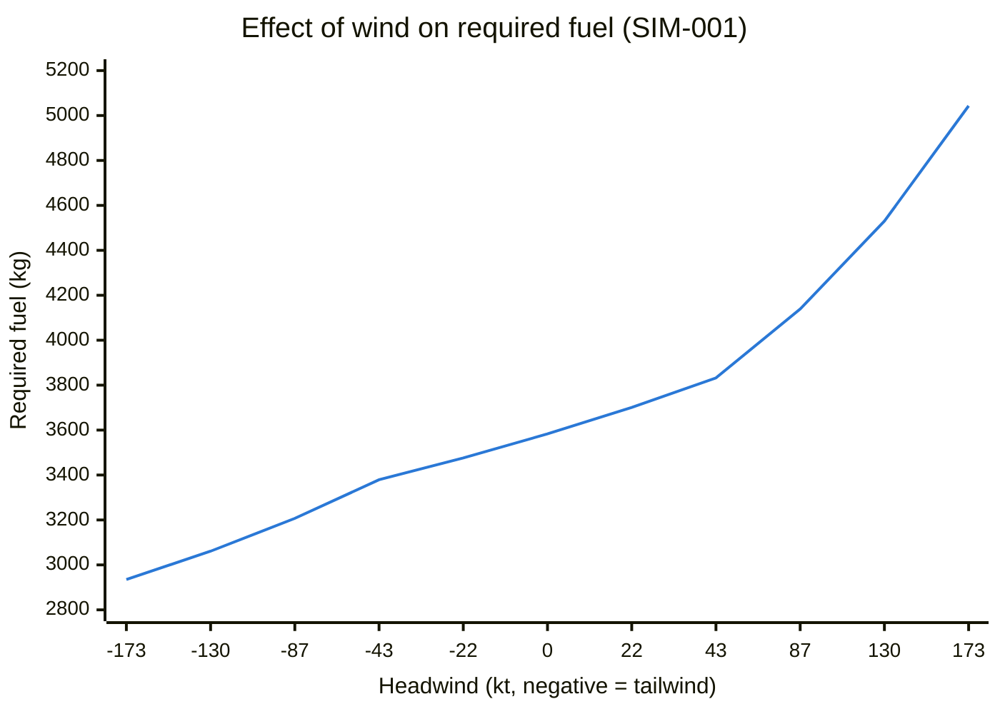

# AFRM test graphs

Made from `test_results_2026-10-28_16-03-57.csv` and `data\test_flights.csv`.

## Expected results

Split of expected results across all test flights.

## Tests passed per category

Number of tests passed in each category.

## Rejected inputs by cause

Which input caused each rejected test.

## Required fuel against distance

Average required fuel in each 500 nm band (typical tests). Lines: blue = SIM-001 Narrow-body jet, orange = SIM-002 Regional turboprop, green = SIM-003 Military transport, yellow = SIM-004 Business jet.

## Effect of wind on required fuel

Required fuel for SIM-001 in the wind tests, against the headwind component.

